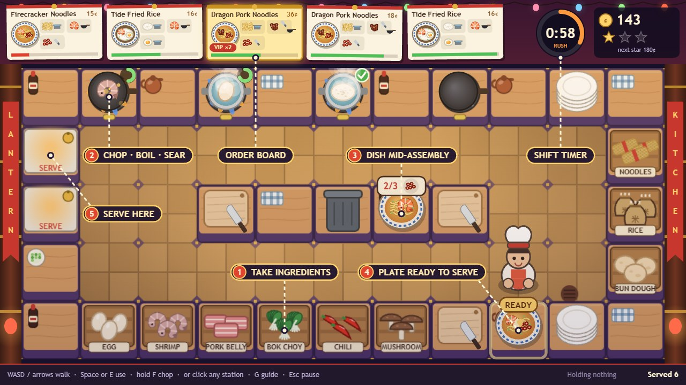
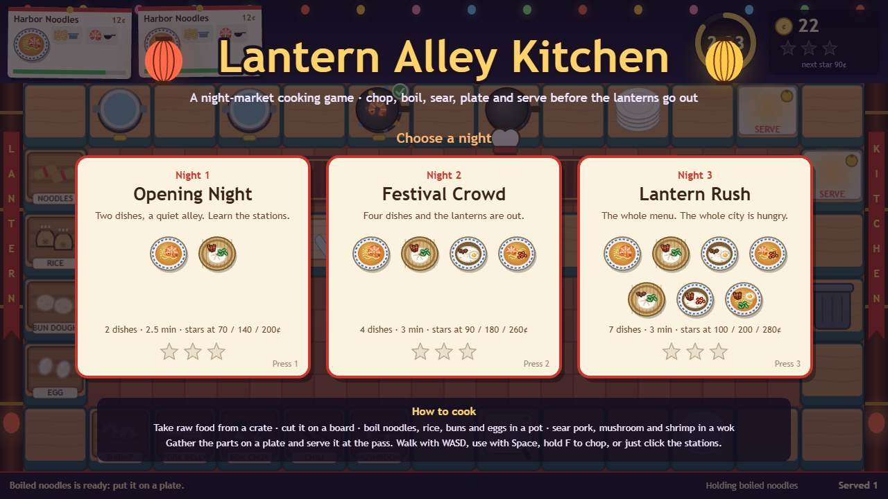
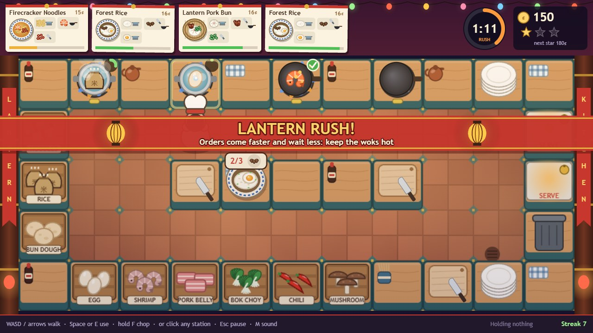

# Lantern Alley Kitchen

**A night-market cooking game for the desktop browser, played with keyboard and mouse.**
Run a tiny street kitchen under the lanterns: take raw food from the crates, cut it on a board,
boil it in a stock pot or sear it in a wok, gather the finished parts on a plate and serve it at the
pass before the ticket's patience runs out.

**[▶ Play it in your browser](https://wicakhendrik.github.io/makefun-make-the-best-cooking-game/)**
· plain HTML, Canvas2D and ES modules · no build step · no dependencies · works offline · MIT



| | |
| --- | --- |
|  |  |
| Pick one of three nights, each in its own stall. | The rush banner swings in and the stoves fill up. |

## What is in it

- **Three nights in three stalls.** Opening Night at the Harbor Stall (2 dishes), Festival Crowd on
  the Bridge Market (5 dishes) and Lantern Rush at the Lantern Gate (all 10). Each stall puts the
  crates, pots, woks and pass in different places, with its own floor and counter colours, so every
  night is a new route to learn.
- **Ten dishes from nine ingredients.** Harbor Noodles, Lantern Pork Bun, Forest Rice, Firecracker
  Noodles, Garden Bun, Ember Rice, Midnight Ramen, Tide Fried Rice, Dragon Pork Noodles and Moon Egg
  Bun. The same parts combine in different ways, and each ingredient has its own route (pork belly
  is cut and then seared; noodles only boil), so every ticket is a small route to plan.
- **VIP tickets in the rush.** From halfway through a night a gold ticket may arrive from a lantern
  guest. It pays double but waits less, and a VIP's plate is filled first.
- **Pressure that grows without chores.** Tickets come faster and wait less as the night goes on,
  finished food burns if it is left in the pot, and the lantern rush takes the last 40% of the night.
- **Readable at a glance.** A plate part-way to an order wears a tag ("2/3" and the parts it still
  lacks), a finished one a gold READY tag. Press **G** for the kitchen guide: numbered callouts for
  the route of a dish (ingredients, stove, assembly, ready, pass) plus the order board and timer.
- **Tips and streaks.** A fast serve earns a tip, and an unbroken streak adds a bonus.
- **All original.** Art, sounds and music are drawn or synthesized in code. Nothing is loaded from the
  network.

## Controls

| Action | Keyboard | Mouse |
| --- | --- | --- |
| Walk | WASD or arrow keys | click a station and the chef walks there |
| Take / put down / plate / serve | Space or E (at the station you face) | click the station |
| Chop | hold F (or J) at a board | click a board with food on it |
| Kitchen guide | G | |
| Pause, sound | Esc or P, M | |

## Run it locally

```sh
node serve.ts            # then open http://localhost:8080 in desktop Chrome
```

`game/` is plain static files, so any static server works too (`npx serve game`, or
`python -m http.server` from inside `game/`).

## How it is built

The game is a fixed-step simulation (seeded random numbers, so a night is reproducible) with the
drawing kept apart from the rules.

| Path | Job |
| --- | --- |
| `game/src/night.js` | steps one night: clock, phases, the rush |
| `game/src/kitchen.js` | station rules: crates, boards, pots, woks, plates, the pass |
| `game/src/chef.js` | movement and click-to-walk pathfinding |
| `game/src/orders.js` | the order board: tickets, patience, tips, streaks, VIPs |
| `game/src/recipes.js` | ingredients, routes, dishes and the three shifts |
| `game/src/autochef.js` | a demo chef that plays by clicking stations, as a mouse player would |
| `game/src/render/` | kitchen art, food art, HUD, effects, screens and the kitchen guide |
| `game/src/audio.js` | sounds and music synthesized with the Web Audio API |
| `tools/simulate.mjs` | plays every night headless with the demo chef, to check the pacing |
| `tools/shoot.mjs` | takes `screenshots/` with headless Chrome from the scenes in `shots.json` |

The demo chef drives the title screen's background kitchen, the balance checks and the screenshots,
so the screenshots are real frames of real play.

## Background

I built this with [Claude Code](https://claude.com/claude-code) for make.fun's *Make the best
cooking game* bounty, over about ten hours in a single session. The AI judge compares entries from a
contact sheet of screenshots and an outline of the source. The entry reached the top 5% of the field
in the third round, then fell short of the top 10 in the final, where the winners had longer
campaigns, more dishes and bolder themes. The next version of an idea like this would start from
those: a more unusual setting, more dishes and a longer run of nights.

## License

[MIT](LICENSE)
